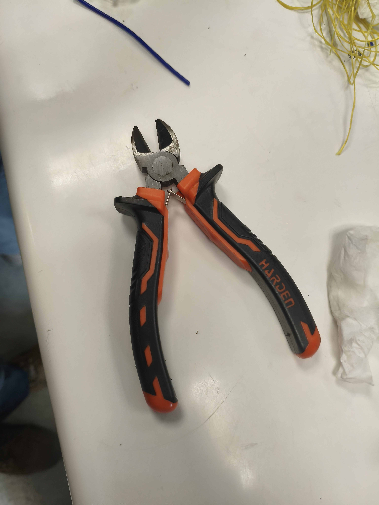
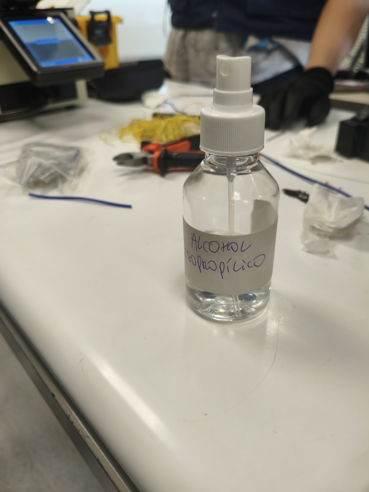
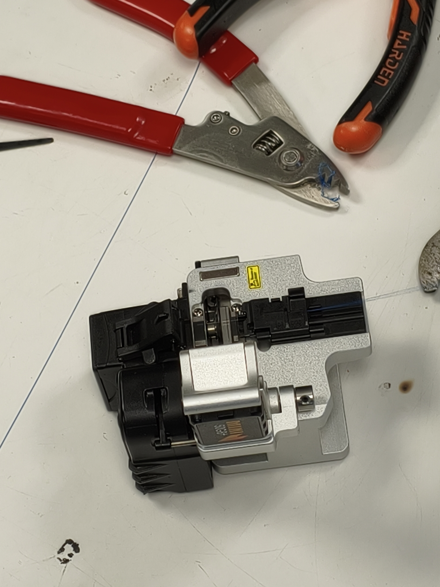
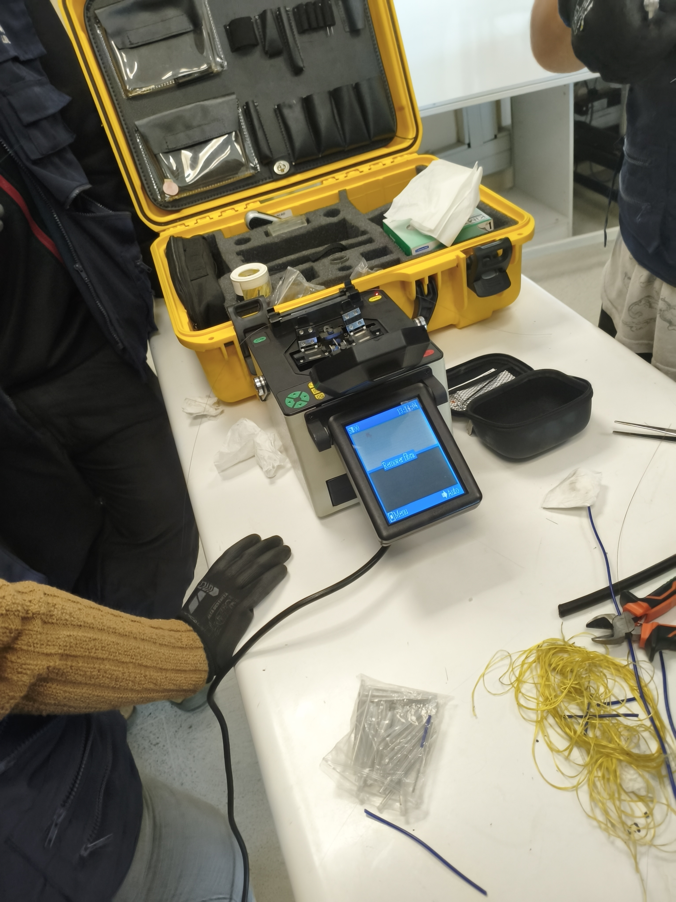
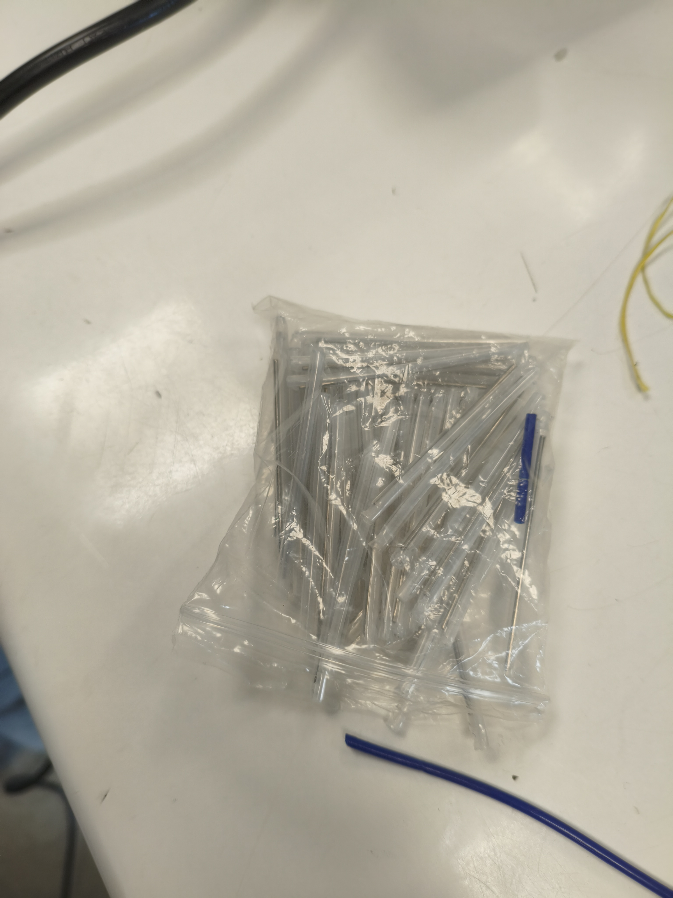

# Manual práctico: Introducción a la "Fusión de Fibra Óptica"

📖 **Asignatura:** Infraestructura de Redes (TCB304)

👤 **Autor:** Gabriel Díaz

📍 **Objetivo:** Implementar redes de fibra óptica considerando las recomendaciones de seguridad y planificación del proceso: Preparar, limpiar, cortar y termofusionar fibra.

---

## 1. 📚 Glosario técnico 

| 🖋️ Término | 📑 Definición |
|---|---|
|**Núcleo (Core)** | Zona central de la fibra por donde se propaga la luz.|
|**Cladding** | Revestimiento óptico que confina la luz dentro del núcleo.|
|**Cleaving** | Corte de precisión  que deja la cara de la fibra plana y cerca de 90 grados.|
|**Atenuación**| Disminución de la potencia óptica durante la transmisión.|
|**Empalme por fusión**|	Unión permanente de dos extremos de fibra mediante una fusionadora.|
|**Pérdida de inserción**|	Reducción de potencia óptica al atravesar un componente o empalme.|
|**Pigtail**|	Tramo corto de fibra óptica que tiene un conector instalado en uno de sus extremos.|
|**Manga termorretráctil**|	Protector que se contrae con calor para proteger mecánicamente el empalme.|

---

## 2. 🛠️ Herramientas y materiales
- Pinza peladora de fibra óptica (stripper).
- Cortadora de precisión (cleaver).
- Fusionadora de fibra óptica.
- Alcohol isopropílico de alta pureza.
- Paños libres de pelusa.
- Protector termorrectráctil (heat shrink).
- Contenedor para residuos.
- Fibra óptica para la práctica.
- Lentes de seguridad.

**Justificación técnica:**
Cada herramienta cumple una función específica durante el proceso de fusión, su correcta utilización permite evitar daños en la fibra, contaminación de los extremos y errores durante el empalme.

---

## 3. 🦺 Seguridad y manejo de materiales
> 🚨 **Advertencia:** Nunca mirar directamente el extremo de una fibra óptica, aunque parezca que no transmite señal.

**⚠️Riesgos:**

- Fragmentos microscópicos de vidrio.

- Rotura accidental de la fibra.

- Contaminación de los extremos.

- Lesiones por manipulación incorrecta de herramientas.

- Riesgos asociados a equipos eléctricos y superficies calientes.

**✅Medidas preventivas:**

 - Usar lentes de seguridad (EPP).
 
 - No tocar los fragmentos de fibra con los dedos.
 
 - Depositar los residuos a un contenedor.
 
 - Mantener el área de trabajo limpia y ordenada.
 
 - No comer ni beber durante la práctica.

 - No mirar directamente dentro de conectores o extremos de fibra.

---

## 4. 🔧 Preparación del área de trabajo

Antes de comenzar el procedimiento de fusión, es necesario preparar el espacio y comprobar que todos los materiales se encuentren disponibles.

**Procedimiento:**
1. Identificar el tipo de fibra y los materiales disponibles.
2. Verificar el estado de las herramientas.
3. Organizar los materiales sobre una superficie limpia.
4. Ubicar el contenedor de residuos cerca del área de trabajo.
5. Distribuir las funciones entre los integrantes del equipo u individualmente.
   
**Resultado esperado:**
Contar con un espacio de trabajo organizado, seguro y con todos los elementos necesarios para realizar el procedimiento.

---

## 5. ✂️ Stripping: pelado de la fibra

El stripping consiste en retirar las capas protectoras de la fibra óptica para dejar expuesto el vidrio, permitiendo realizar posteriormente la limpieza y el corte de precisión.

**Herramienta utilizada:** Pinza peladora de fibra óptica (Stripper).

**Procedimiento:**
1. Sujetar la fibra con firmeza y ubicarla en la ranura correspondiente de la pinza.
2. Retirar la chaqueta exterior y el buffer.
3. Retirar el recubrimiento acrilato en tramos cortos, deslizando la pinza en línea recta.
4. Comprobar que el vidrio quedó expuesto, sin restos de recubrimiento.
5. Revisar que la fibra no tenga marcas, dobleces ni daños visibles.
6. Depositar los restos en el contenedor de residuos.

**Imagen representativa:**

> [!WARNING]
> **Error común:** Utilizar una ranura incorrecta o aplicar demasiada fuerza puede provocar rayaduras o fracturas en la fibra.

**Resultado esperado:**
Obtener una fibra desnuda, sin restos de recubrimiento y sin daños visibles.

---

## 6. 🧼 Limpieza de precisión
La limpieza permite eliminar residuos, polvo e impurezas que pueden afectar la calidad y provocar pérdidas de señal.

**Materiales utilizados:**
- Alcohol isopropílico de alta pureza.
- Paños libres de pelusa.
  
**Procedimiento:**
1. Preparar los materiales de limpieza.
2. Aplicar el procedimiento de limpieza indicado por el docente.
3. Utilizar una zona limpia del paño para evitar transferir suciedad.
4. Evitar tocar la fibra desnuda con los dedos.
5. Esperar a que el alcohol se evapore completamente.

**Imagen representativa:**

   
> [!WARNING]
> **Error común:** Una limpieza incompleta puede provocar contaminación en los extremos de la fibra y afectar el resultado de la fusión.

**Resultado esperado:**
Obtener una superficie de vidrio limpia y libre de residuos visibles.

---

## 7. 📐 Cleaving: corte de precisión
El cleaving consiste en realizar un corte preciso en el extremo de la fibra óptica, procurando obtener una superficie plana y perpendicular al eje de la fibra.

**Herramienta utilizada:** Cortadora de precisión (Cleaver).

**Procedimiento:**
1. Verificar que la cortadora se encuentre limpia.
2. Colocar la fibra pelada y limpia.
3. Cerrar las tapas de sujeción.
4. Accionar el mecanismo de corte siguiendo las indicaciones del fabricante.
5. Retirar la fibra con cuidado, sin tocar la cara de corte.
6. Depositar el fragmento sobrante en el contenedor de residuos.

  **Imagen representativa:**

  
> [!WARNING]
> **Error común:** Un corte inclinado, irregular o contaminado puede dificultar la alineación y aumentar las pérdidas del empalme.

**Resultado esperado:**
Obtener un extremo de fibra con un corte regular, adecuado para realizar el proceso de termofusión.

---

## 8. ⚡ Proceso de termofusión
La termofusión consiste en unir dos extremos de fibra óptica mediante una fusionadora, que realiza la alineación de las fibras y aplica un arco eléctrico para generar una unión permanente.

**Equipo utilizado:** Fusionadora de fibra óptica.

**Etapas generales del procedimiento:**
1. Verificar que ambos extremos de fibra estén preparados y limpios.
2. Comprobar que la fusionadora esté configurada para el tipo de fibra utilizado.
3. Colocar los extremos en los soportes correspondientes.
4. Cerrar la tapa del equipo.
5. Observar el proceso de alineación realizado por la máquina.
6. Ejecutar el ciclo de fusión según indicado.
7. Revisar el resultado y la pérdida estimada indicada por el equipo.

**Imagen representativa:**

   
**Resultado esperado:**
Obtener una unión entre ambas fibras, correctamente alineada y sin alertas del equipo.

> [!IMPORTANT]
> Los parámetros de funcionamiento pueden variar según el modelo de fusionadora y el tipo de fibra; no modificar configuraciones sin autorización.

---

## 9. 🛡️ Protección del empalme
Después de realizar la termofusión, es necesario proteger la unión para evitar daños mecánicos durante su manipulación e instalación.

**Material utilizado:** Protector termorretráctil.

**Procedimiento:**
1. Deslizar el protector hasta cubrir la zona.
2. Colocar la fibra en el soporte correspondiente.
3. Utilizar el horno de protección de acuerdo con las indicaciones.
4. Esperar el tiempo de enfriamiento recomendado.
5. Comprobar que el protector se encuentre correctamente centrado.

**Imagen representativa:**

   
**Resultado esperado:**
Obtener un empalme protegido, firme y preparado para su posterior manipulación.
   
